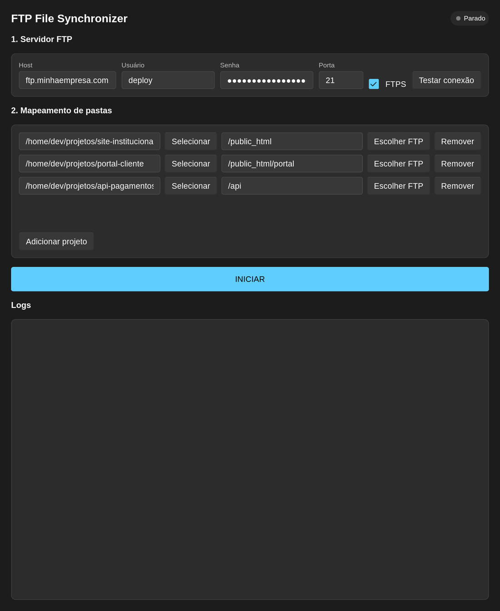
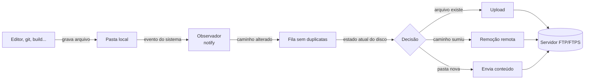

<div align="center">


# FTP File Synchronizer

**Salve no editor, veja no servidor.**

Monitora suas pastas locais e envia cada alteração para o servidor FTP/FTPS em tempo real.<br>
Funciona com qualquer editor. Leve, nativo e multiplataforma.

[](https://github.com/edenilsonmota/ftp-file-synchronizer/releases/latest)
[](https://github.com/edenilsonmota/ftp-file-synchronizer/actions/workflows/ci.yml)
[](LICENSE)
[](#-instalação)
[](https://slint.dev)

[**Instalação**](#-instalação) · [**Funcionalidades**](#-funcionalidades) · [**Como usar**](#-como-usar) · [**Como funciona**](#%EF%B8%8F-como-funciona) · [**Desenvolvimento**](#%EF%B8%8F-desenvolvimento)

<br>



</div>

---

## ⚡ Por que existe

Muitos projetos ainda são publicados por FTP: hospedagens compartilhadas, servidores legados, ambientes de homologação. O fluxo costuma ser salvar, abrir um cliente FTP, achar a pasta e arrastar o arquivo. A cada alteração.

As extensões de editor resolvem parte do problema, mas prendem você a um editor e só enxergam o que é salvo por ele. Um `git checkout`, um build ou um arquivo gerado por outra ferramenta ficam de fora.

O **FTP File Synchronizer** observa a pasta direto no sistema de arquivos. Qualquer alteração, venha de onde vier, chega ao servidor em menos de dois segundos.

---

## ✨ Funcionalidades

- **🔄 Sincronização em tempo real.** Criou, editou, renomeou ou apagou: o servidor acompanha.
- **📁 Vários projetos ao mesmo tempo.** Mapeie quantas pastas quiser, cada uma para seu destino remoto.
- **🧭 Navegador de pastas do FTP.** Escolha a pasta remota navegando no servidor, sem digitar caminhos.
- **🔒 FTPS e cofre de senhas.** TLS explícito validado pelos certificados do sistema; a senha fica no Windows Credential Manager, no Keychain do macOS ou no Secret Service do Linux.
- **📦 Pastas inteiras.** Uma pasta criada ou renomeada tem todo o conteúdo enviado.
- **🛡️ Exclusões com segurança.** Se a pasta do projeto sumir (disco desmontado, rede caiu), nada é apagado no servidor.
- **🧹 Ignora o que não deve subir.** `node_modules`, `.git`, `.vscode` e `desktop.ini` ficam de fora.
- **🔁 Resiliente.** Novas tentativas com reconexão automática e conexão mantida viva durante períodos ociosos.
- **🪶 Leve.** Binário nativo de cerca de 20 MB, instaladores de cerca de 10 MB, sem navegador embutido.
- **🖥️ Multiplataforma de verdade.** Mesma interface no Windows, Linux (X11 e Wayland) e macOS, testada nos três a cada alteração.

---

## 📊 Extensão de editor vs. FTP File Synchronizer

| | Extensão FTP do editor | FTP File Synchronizer |
|---|---|---|
| **Funciona com qualquer editor** | ❌ Uma extensão por editor | ✅ **Zed, VS Code, Cursor, Sublime, Notepad++...** |
| **Detecta `git checkout`, builds e geradores** | ❌ Só o que o editor salva | ✅ **Qualquer alteração no disco** |
| **Vários projetos simultâneos** | ⚠️ Um workspace por vez | ✅ **Todos ao mesmo tempo** |
| **Senha fora do arquivo de projeto** | ⚠️ Geralmente em `sftp.json` | ✅ **Cofre de senhas do sistema** |
| **Continua com o editor fechado** | ❌ | ✅ |

---

## 🚀 Instalação

Baixe o pacote do seu sistema na página de [**Releases**](https://github.com/edenilsonmota/ftp-file-synchronizer/releases/latest).

| Sistema | Pacote |
|---|---|
| **Windows** | `FTP File Synchronizer_x.x.x_x64-setup.exe` |
| **macOS (Apple Silicon)** | `FTP File Synchronizer_x.x.x_aarch64.dmg` |
| **macOS (Intel)** | `FTP File Synchronizer_x.x.x_x64.dmg` |
| **Debian / Ubuntu** | `ftp-file-synchronizer_x.x.x_amd64.deb` |
| **Arch Linux** | `ftp-file-synchronizer-x.x.x-1-x86_64.pkg.tar.zst` |
| **Qualquer Linux** | `ftp-file-synchronizer_x.x.x_x86_64.AppImage` |

<details>
<summary><b>Linux: comandos de instalação e desinstalação</b></summary>

#### AppImage

```bash
chmod +x ftp-file-synchronizer_x.x.x_x86_64.AppImage
./ftp-file-synchronizer_x.x.x_x86_64.AppImage
```

Para desinstalar, apague o arquivo.

#### Debian / Ubuntu

```bash
sudo apt install ./ftp-file-synchronizer_x.x.x_amd64.deb   # instalar
sudo apt remove ftp-file-synchronizer                      # desinstalar
```

#### Arch Linux

```bash
sudo pacman -U ftp-file-synchronizer-x.x.x-1-x86_64.pkg.tar.zst   # instalar
sudo pacman -Rns ftp-file-synchronizer                            # desinstalar
```

A desinstalação mantém as configurações salvas.

</details>

> [!NOTE]
> **macOS:** enquanto o aplicativo não é assinado e notarizado pela Apple, o sistema bloqueia a primeira abertura. Depois de copiá-lo para **Aplicativos**, libere-o com:
>
> ```bash
> xattr -dr com.apple.quarantine "/Applications/FTP File Synchronizer.app"
> ```

> [!NOTE]
> **Windows:** o instalador ainda não é assinado digitalmente. Se o SmartScreen aparecer, clique em **Mais informações → Executar assim mesmo**.

---

## 🧭 Como usar

1. Preencha **host**, **usuário**, **senha** e **porta**. Marque **FTPS** se o servidor suportar e clique em **Testar conexão**.
2. Em **Mapeamento de pastas**, escolha a pasta local e a pasta remota (digite, como `/public_html/site`, ou use **Escolher FTP**).
3. Clique em **INICIAR**.
4. Trabalhe normalmente: cada alteração aparece no log e chega ao servidor.

> [!TIP]
> Abrir o aplicativo de novo traz a janela que já está aberta, em vez de iniciar uma segunda cópia. Fechar a janela encerra a sincronização e salva a configuração.

---

## ⚙️ Como funciona



Os eventos de arquivo variam entre Windows, Linux e macOS: renomeações chegam de formas diferentes, eventos vêm agrupados ou com tipos genéricos. Por isso a fila guarda apenas **qual caminho mudou**, e a ação é decidida no momento do envio olhando o disco. Esse é o motivo de o comportamento ser o mesmo nos três sistemas.

Todo envio usa modo binário, preservando imagens, arquivos compactados e quebras de linha exatamente como estão no disco.

<details>
<summary><b>Estrutura do projeto</b></summary>

Workspace Cargo com dois crates:

| Caminho | Responsabilidade |
|---|---|
| `crates/sync-core/src/config.rs` | Persistência da configuração e cofre de senhas |
| `crates/sync-core/src/validate.rs` | Validação da configuração |
| `crates/sync-core/src/ftp.rs` | Cliente FTP/FTPS |
| `crates/sync-core/src/engine.rs` | Observador de pastas, fila e envio |
| `crates/sync-core/src/remote_path.rs` | Caminhos remotos |
| `crates/app/ui/app.slint` | Interface |
| `crates/app/src/main.rs` | Ligação entre interface e motor |
| `crates/app/src/single_instance.rs` | Instância única |

`sync-core` não depende da interface e é testado isoladamente.

</details>

<details>
<summary><b>Ícones no Linux</b></summary>

O nome do binário, o `app_id` da janela no Wayland, o `WM_CLASS` no X11, o arquivo `ftp-file-synchronizer.desktop` e os ícones em `/usr/share/icons/hicolor/<tamanho>/apps/ftp-file-synchronizer.png` usam o mesmo identificador (`sync_core::APP_ID`). É isso que permite a qualquer ambiente (GNOME, KDE, Hyprland, Sway e outros) associar a janela ao ícone correto.

</details>

---

## 🛠️ Desenvolvimento

### Pré-requisitos

- Rust estável via [rustup](https://rustup.rs).
- No Linux, bibliotecas de desenvolvimento:
  - **Debian/Ubuntu:** `sudo apt install libfontconfig1-dev libxkbcommon-dev libwayland-dev libx11-dev libxcursor-dev libxrandr-dev libxi-dev libgl1-mesa-dev libdbus-1-dev`
  - **Arch:** `sudo pacman -S fontconfig libxkbcommon wayland`
- Opcional: extensão do [Slint](https://slint.dev) no editor, para pré-visualizar a interface ao vivo.

### Comandos

```bash
cargo run -p ftp-file-synchronizer        # inicia o aplicativo
cargo test --workspace                     # testes (servidor FTP real e observador de pastas)
cargo clippy --workspace --all-targets     # análise estática
cargo fmt --all                            # formatação
```

### Pacotes locais

```bash
cargo install cargo-packager --locked
cargo build --release -p ftp-file-synchronizer
cargo packager --release -p ftp-file-synchronizer
```

Os pacotes vão para `dist/`. No Linux são gerados `.deb`, AppImage e um `PKGBUILD`. Numa máquina Arch, rode `makepkg --nodeps` dentro de `dist/` para obter o `.pkg.tar.zst`. Em distribuições muito recentes, gere o AppImage com `NO_STRIP=1`.

### Integração contínua e releases

| Workflow | Quando roda | O que faz |
|---|---|---|
| [`ci.yml`](.github/workflows/ci.yml) | Push e pull request | Formatação, Clippy, testes e build no Windows, Linux e macOS |
| [`release.yml`](.github/workflows/release.yml) | Tag `v*` | Gera os instaladores dos três sistemas e publica a release |

```bash
git tag v3.0.0
git push origin v3.0.0
```

O pacote Linux é compilado no Ubuntu 22.04 para continuar compatível com distribuições mais antigas.

---

## 🤝 Contribuindo

Issues e pull requests são bem-vindos. Antes de abrir um PR, rode `cargo fmt --all`, `cargo clippy --workspace --all-targets -- -D warnings` e `cargo test --workspace`. A CI repete as três verificações nos três sistemas.

---

## 📄 Licença

Distribuído sob a licença [MIT](LICENSE).

<div align="center">
<br>
Criado por <a href="https://github.com/edenilsonmota">Edenilson Mota</a> · Interface feita com <a href="https://slint.dev">Slint</a>
</div>
